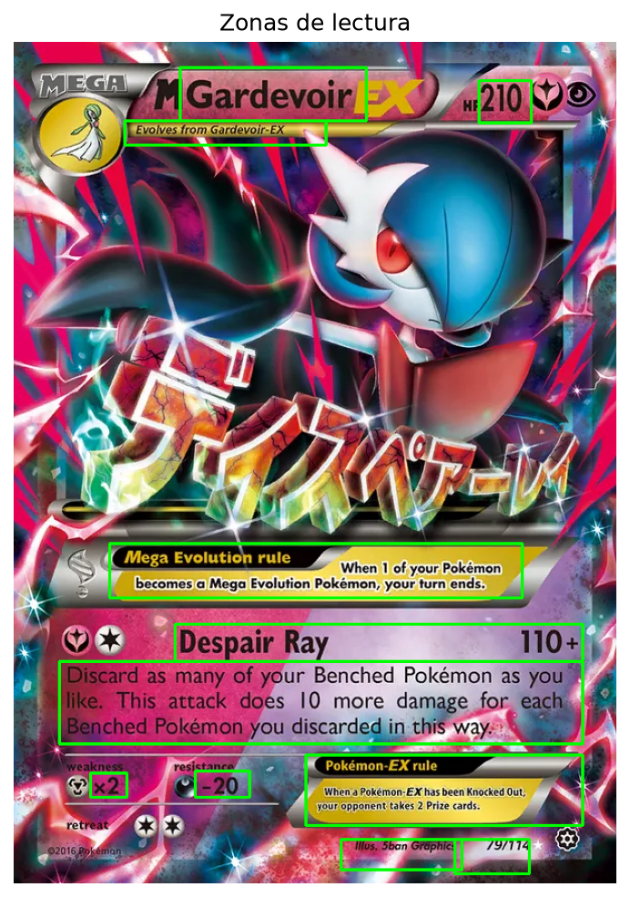
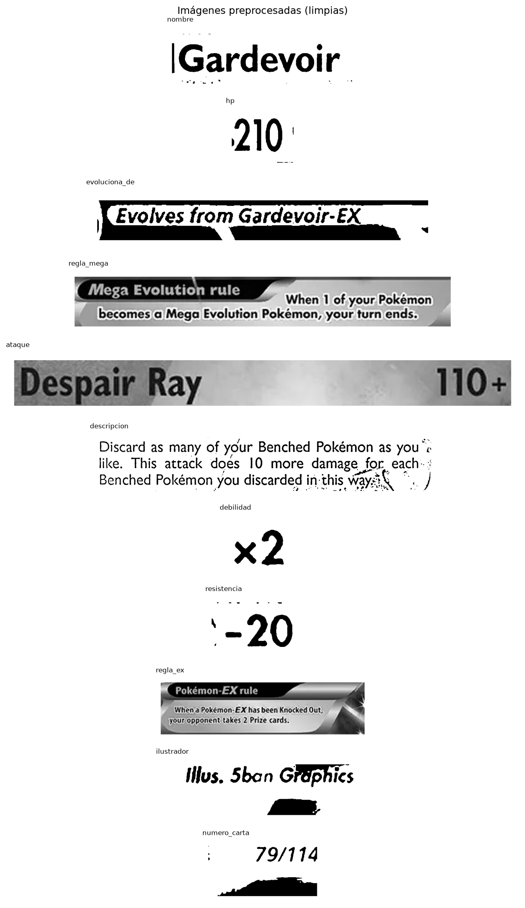

# De imagen a CSV con OpenCV y Tesseract OCR

Proyecto académico (Sistemas de Big Data, Unidad 1, Tarea 1.4) que transforma un dato no estructurado (la imagen de una carta Pokémon, *M Gardevoir EX*) en un dato estructurado (un CSV), usando preprocesado de imagen con OpenCV y reconocimiento de texto con PyTesseract.

## Características

- Divide la carta en **zonas** (nombre, HP, ataque, descripción, reglas...) y preprocesa cada una por separado.
- Reconocimiento de texto con Tesseract, con **intentos alternativos** si una zona no devuelve lo esperado.
- Limpieza y estructuración del texto (eliminación de ruido, separación del ataque y su daño, correcciones manuales).
- Exportación a CSV (una fila, una columna por campo) y guardado del texto en bruto para revisión.
- Imágenes de apoyo del proceso en la carpeta `img/`.

## Tecnologías utilizadas

- Python 3.14 gestionado con [uv](https://docs.astral.sh/uv/)
- [opencv-python](https://pypi.org/project/opencv-python/) (preprocesado de imagen)
- [pytesseract](https://pypi.org/project/pytesseract/) y [Tesseract OCR](https://github.com/UB-Mannheim/tesseract/wiki) (reconocimiento de texto)
- [Pillow](https://python-pillow.org/) y [matplotlib](https://matplotlib.org/)

## Requisitos previos

- uv instalado
- Tesseract OCR instalado en el sistema (en Windows, desde el instalador de UB-Mannheim; en macOS `brew install tesseract`; en Linux `sudo apt install tesseract-ocr`) y anotada su ruta de instalación

## Instalación y configuración

1. Clona el repositorio y entra en la carpeta de la tarea:
   ```bash
   git clone https://github.com/ChristianAM5/Sistemas_De_Big_Data
   cd Unidad1/Tarea1_4
   ```
2. Instala las dependencias:
   ```bash
   uv sync
   ```
3. Abre el script y modifica estas constantes del bloque `Configuración`, al principio del archivo:

   | Constante | Qué hay que cambiar |
   |---|---|
   | `RUTA_TESSERACT` | Ruta del ejecutable de Tesseract en tu equipo (por ejemplo, `C:\Program Files\Tesseract-OCR\tesseract.exe` en Windows o `/usr/bin/tesseract` en Linux). |
   | `IMAGEN` | Nombre de la imagen a analizar. Debe estar en la **misma carpeta que el script**. |
   | `NOMBRE_BASE` | Nombre que se usará para el archivo de salida (`<NOMBRE_BASE>.csv`). |

   Si cambias de imagen, ten en cuenta que las coordenadas de las zonas (`ZONAS`) están ajustadas a la carta incluida; consulta el apartado de limitaciones.

## Guía de uso

```bash
uv run 1_4_Alvarez_Martinez_Christian.py
```

Se abrirán dos ventanas con las zonas de lectura y las zonas preprocesadas (las imágenes también se guardan en `img/`). Ciérralas para que el script continúe. Al terminar se generan:

- `1_4_Alvarez_Martinez_Christian.csv`: el resultado estructurado.
- `ocr_bruto.txt`: el texto leído por el OCR en cada zona, sin limpiar.

## Cómo funciona

1. **Carga** de la imagen (`Gardevoir.png`).
2. **Preprocesado por zonas:** recorte, escala de grises, ampliado y umbralizado (fijo, Otsu o adaptativo según la zona). Aplicar un único umbral a toda la carta no funciona, porque los colores del fondo hacen que Tesseract pierda parte del texto.
3. **OCR** de cada zona con `pytesseract`. Si el texto no cumple el formato esperado, se prueban ajustes alternativos.
4. **Limpieza:** se descartan líneas de ruido, se corrigen errores típicos (`Pokemon` → `Pokémon`, `this ways` → `this way`) y se restituye el signo `-` de la resistencia cuando el OCR lo pierde.
5. **Exportación** a CSV.

## Resultados

Zonas de la carta que se leen:



Cómo queda cada zona tras el preprocesado:



Contenido del CSV generado:

| Campo | Valor |
|---|---|
| nombre | Gardevoir |
| hp | 210 |
| evoluciona_de | Gardevoir-EX |
| ataque | Despair Ray |
| danio | 110+ |
| descripcion_ataque | Discard as many of your Benched Pokémon as you like. This attack does 10 more damage for each Benched Pokémon you discarded in this way. |
| regla_mega | When 1 of your Pokémon becomes a Mega Evolution Pokémon, your turn ends. |
| regla_ex | When a Pokémon-EX has been Knocked Out, your opponent takes 2 Prize cards. |
| debilidad | ×2 |
| resistencia | -20 |
| ilustrador | Illus. 5ban Graphics |
| numero_carta | 79/114 |

## Limitaciones

- Las coordenadas de las zonas están ajustadas a esta imagen (599×836 px) y a esta plantilla de carta. Para otras cartas con la misma plantilla habría que revisarlas, y para cartas con otra disposición (dos ataques, habilidades, cartas de entrenador) habría que definir zonas nuevas.
- El OCR no lee los iconos (tipos de energía, coste de retirada) ni la "M" y el "EX" del nombre, por su tipografía estilizada. El texto japonés de la ilustración se ignora a propósito.
- Distintas versiones de Tesseract pueden leer algunas zonas de forma ligeramente distinta; por eso existen los intentos alternativos y la limpieza posterior.

## Estructura del proyecto

```
Tarea1_4/
├── 1_4_Alvarez_Martinez_Christian.py   # Script principal
├── 1_4_Alvarez_Martinez_Christian.csv  # Resultado estructurado
├── Gardevoir.png                       # Imagen de entrada
├── ocr_bruto.txt                       # Texto en bruto del OCR
├── img/
│   ├── zonas_marcadas.png
│   └── zonas_preprocesadas.png
├── requirements.txt
└── README.md
```

## Autor

Christian Álvarez Martínez

## Licencia

Distribuido bajo la licencia [GNU General Public License v3.0](https://www.gnu.org/licenses/gpl-3.0.html). Consulta el archivo `LICENSE` para más información.
